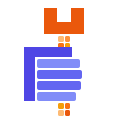

<div align="center">



# handily

**Mods for Claude Code. Panes, bands and quiet rows that show your work items,
your tasks and your sessions, for any tracker.**

[](https://github.com/niksavis/handily/actions/workflows/basicly-gates.yml)
[](https://github.com/niksavis/handily/actions/workflows/release.yml)
[](#early-development)
[](#requirements)
[](LICENSE)

</div>

## What is handily?

handily is a Claude Code plugin marketplace. Each plugin in it is a **mod**. A mod changes what
you see in a Claude Code session in the terminal. The mods show your work items, your tasks,
your sessions and your subagents. They also make long replies and tool calls short on the screen.

The mods work with any tracker, such as basicly, beads or beans. No mod needs basicly.

## Requirements

- The latest Claude Code, in a terminal session. The mods support only the newest Claude Code version.
- The mods run in Claude Code only. Codex and other agents do not load them.

## Early development

> [!WARNING]
> Expect breaking changes in any release. Read [CHANGELOG.md](CHANGELOG.md) before you update.

## Quick start

Type these two lines at the prompt of a Claude Code session:

```text
/plugin marketplace add niksavis/handily
/plugin install handily@niksavis
```

1. The install line opens the details of the plugin. Select **Install**, then close the panel.
2. Type `/reload-plugins`.
3. Type `/handily`. It lists each mod and ends with `handily: 6 of 6 mods loaded, 0 off or paused`.

To install from a shell, run these two lines, then start Claude Code:

```sh
claude plugin marketplace add niksavis/handily
claude plugin install handily@niksavis
```

The marketplace name is `niksavis`, so each install id ends with `@niksavis`. Did you install
from the old marketplace `handily`? Then read
[Move from the handily marketplace](docs/install.md#move-from-the-handily-marketplace).

## Update

In a Claude Code session, this line gets the new versions and updates each installed mod:

```text
/plugin marketplace update niksavis
```

In a shell, the marketplace update gets the new versions only. It does not update an installed
mod. An update of the bundle does not update its mods either. So update each plugin by its id,
in bash or zsh:

```sh
claude plugin marketplace update niksavis
for p in handily handily-workitems handily-quiet-items handily-board handily-item-toasts handily-simple-view handily-reply-view; do claude plugin update "$p@niksavis"; done
```

After an update, type `/reload-plugins` in each open session, or restart Claude Code.
[docs/install.md](docs/install.md#update) has the full steps.

## Check the installed versions

| Where | What to do |
| --- | --- |
| Claude Code session | Type `/handily`. It shows the version, the state and the mode of each mod |
| Claude Code session | Type `/plugin` and open the **Installed** tab |
| Shell | Run `claude plugin list` |

## Mods

| Mod | What you see | Command |
| --- | --- | --- |
| [`handily-workitems`](mods/handily-workitems/README.md) | Nothing. It reads the work items of your tracker for the other mods | `/workitems` |
| [`handily-quiet-items`](mods/handily-quiet-items/README.md) | One short row in place of each tracker write in the transcript | `/quiet-items` |
| [`handily-item-toasts`](mods/handily-item-toasts/README.md) | A toast when a work item changes outside your session | `/item-toasts` |
| [`handily-simple-view`](mods/handily-simple-view/README.md) | One short row for each Bash, Edit, Write, Read, Grep and Glob call | `/simple` |
| [`handily-reply-view`](mods/handily-reply-view/README.md) | Long replies fold, tables draw without box lines, copy buttons, a rule above each prompt | `/replies` |
| [`handily-board`](mods/handily-board/README.md) | A board with two tabs: your tasks and agents, and every local session with its agents | `/board` |
| [`handily`](mods/handily/README.md) | The bundle of all the mods above | `/handily` |

[docs/guide.md](docs/guide.md) lists every command of each mod, with its arguments and its
settings. [docs/install.md](docs/install.md) tells you how to install one mod, update,
uninstall, and move from the old plugin names.

## Documentation

| Page | For |
| --- | --- |
| [docs/guide.md](docs/guide.md) | Each mod, its commands and its settings on one page |
| [docs/install.md](docs/install.md) | Install, update, uninstall, old plugin names, troubleshooting |
| `mods/<name>/README.md` | What each mod draws, its commands and its settings |
| [CHANGELOG.md](CHANGELOG.md) | Every release and each breaking change |
| [CONTRIBUTING.md](CONTRIBUTING.md) | A change to the mods |
| [docs/maintaining.md](docs/maintaining.md) | A release, the CI and the pinned versions |
| [docs/design.md](docs/design.md) | The design, the decisions and the open questions |
| [docs/mocks.md](docs/mocks.md) | The approved text mocks |

## Contributing

Open a GitHub issue for a bug or an idea. [CONTRIBUTING.md](CONTRIBUTING.md) gives the setup.

## License

Released under the [MIT License](LICENSE).
